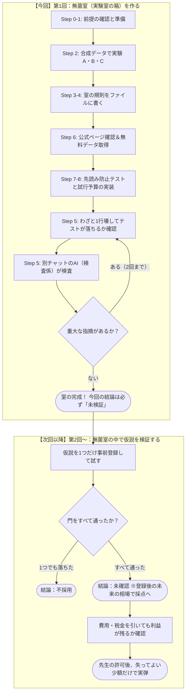

# 無菌室のイメージと、最後にできるシステム（学生向けガイド）

この文書は、作業用プロンプトの「地図」です。プロンプトはAIへの指示書であり、この文書は**あなたが迷子にならないための解説書**です。

今回のプロンプトの目的は、「儲かる銘柄やモデルを探すこと」ではありません。**「儲かったように見えるだけの勘違い（偽陽性）」を、自分の資産を賭ける前に机の上で止めるための実験室（＝無菌室）を作ること**です。

---

## 1. 全体像と「今日やること」

このプロジェクトは、大きく2つのフェーズに分かれています。**今回のプロンプトで作るのは、前半の「無菌室の箱」まで**です。モデルを作ったり、実際の株で儲かるかを試したりするのは、箱が完成した後の「次回以降」です。

### なぜ「儲かるモデル探し」より先に箱を作るのか？

機械学習の授業では、次の前提が成り立っていました。
- データをランダムに混ぜて `train_test_split`（8割で学習、2割でテスト）してよい
- テスト精度が高ければ、良いモデルである
- テストコードが緑（Pass）なら、実装は正しい

しかし、**株価データではこの前提がすべて壊れます**。
株のデータは時間の順に並んでおり、隣の行と期間が重なっています。また、AIを使えば午後のうちに何十通りものパラメータを試せてしまうため、「たまたま運が良かっただけの設定」が簡単に見つかります。

実験室に外から「菌」が入ると実験結果が信用できなくなるように、株の実験でも以下の「菌」が入ると、どんなダメな手法でも「儲かる」という結果が出てしまいます。
1. **未来の情報の混入（先読み）**
2. **何度も試して一番良い結果だけを報告すること（試行回数の無視）**
3. **手数料やスプレッドを0円にすること**
4. **今生き残っている銘柄だけでテストすること（生存者バイアス）**

この「菌」を自動で検知してブロックする仕組みが**無菌室**です。

---

## 2. 今回の作業で「あなた自身」がやること

コードを書くのはAI（実装係）ですが、**すべてAI任せにはできません**。以下の5つは、プロンプトの途中であなたが自分の手と頭でやる仕事です。

| タイミング | あなたがやること | なぜAIにやらせないのか |
|---|---|---|
| **最初（Step 0）** | AIが3つの質問に答えたら、内容を確認して「続行」と指示する | AIが勝手にファイルを作ったり計算を始めたりするのを防ぐため |
| **実験 A・B・C（Step 2）** | 実行前に**「どうなると思うか（予測）」**を一文で書き、実行後に**「なぜ予想と違ったか（気づき）」**を自分の言葉で書く | 先にAIの解説を読むと、ただの暗記になり「どこで前提が壊れるか」に気づけないため |
| **規則の記録（Step 4）** | 25個の規則の横に、実験 `A` `B` `C` のどれと関係があるかを一語で書く（分からなければ空欄にして質問を残す） | 規則を「ただのルール」ではなく、実験の失敗体験と結びつけるため |
| **データ取得（Step 6）** | JPXやJ-Quantsの公式ページをブラウザで開き、画面の文言をAIにコピペする。APIキーを自分で取得し、安全な場所（環境変数など）に置く | AIの古い記憶でコストや仕様を決めさせないため。また、**APIキーをチャットに貼って漏洩させないため** |
| **検査（Step 5・9）** | 実装が終わったら**「新しいチャット」**を開き、検査係用のプロンプトとファイルを渡して採点させる | 同じチャットのAIに「これで合ってる？」と聞くと、自分が書いたバグを自分で「正しい」と採点してしまうため |

---

## 3. 3つの「気づきの実験」の意味（Step 2）

本物の株価をダウンロードする前に、まずは人工的に作ったデータ（合成データ）で3つの実験を行います。この実験が、あとの「25の規則」の根拠になります。

* **実験A：時系列で分けても、答えが混ざっていれば当たる**
  過去を学習、未来をテストに分けても、特徴量の計算に「未来の情報」が1ミリでも混ざっていれば正解率は跳ね上がります。また、「5日間の収益率」のように期間が重なるラベルを使うと、隣の行を通じて未来の情報が漏れます。**「分け方」だけではカンニングを防げない**ことを確かめます。
* **実験B：実力がゼロでも、50回試せば「大当たり」が出る**
  コイン投げのようなデタラメな戦略でも、50本作って「一番成績が良かった1本」だけを見ると、立派なシャープレシオ（儲かり方の効率を表す点数）が出ます。**「一番良かった点数」をそのまま合格判定に使ってはいけない理由**と、**試す回数に予算（上限）が必要な理由**を確かめます。
* **実験C：テストが「緑（成功）」でも、中身が壊れていることがある**
  2倍にする関数をわざと3倍に壊しても、`assert f(2) == f(2)` というテストは通過してしまいます。自分で書いたテストや、同じチャットのAIによる確認は、自分の勘違いを見逃します。だから**「わざとコードを1行壊してテストが落ちるか確かめる（変異テスト）」**と**「別チャットのAIによる検査」**が必要になります。

---

## 4. 二人のAIの使い分け（Step 5）

この開発では、AIの役割を明確に2つに分けて進めます。

| 役割 | どのチャットか | やること | 絶対にやらないこと |
|---|---|---|---|
| **実装係** | 最初のプロンプトを貼ったチャット | テストを先に書く → 実装する → わざと1行壊してテストが落ちるか確認する → `REVIEW.md` を書いて止まる | 自分で「合格」「完成（done）」と言わない |
| **検査係** | **新しく開いた別チャット**（可能なら別モデル） | 渡されたコードとテストを自分で実行し、自分で1箇所壊してテストが落ちるか確かめ、合否の表だけを返す | **コードを自分で直さない**（直した時点で失格）。テストの基準を緩めない |

※検査係が不合格を出したら、あなたはその指摘だけを実装係にコピペして直させます（差し戻しは2回まで。3回目もダメなら先生に相談してストップします）。

---

## 5. なぜここまで厳しくするのか？（背景にある事実と論文）

「たかが学生の実験に、なぜここまで厳しいルールと論文の実装が必要なのか？」と思うかもしれません。理由は、**過去に世界中の優秀な人たちが、ルールなしのバックテストで失敗したから**です。

### クアントピアン（Quantopian）の失敗

2012年に始まった「Quantopian」は、世界中の誰もがブラウザ上で売買ルールを作り、過去データで模擬試験（バックテスト）をして、成績が良いものを実際のファンドで運用するサービスでした。しかし、運用成績は振るわず、2020年にサービスは閉鎖されました。

閉鎖前の2016年、同社の研究者たちが、ユーザーが作った888本のルールについて「過去データの成績（バックテスト）」と「ルールを作った後の実際の成績（標本外）」を比較した論文（*"All That Glitters Is Not Gold"*：輝くものすべてが金とは限らない）を発表しています。

* **過去の点数は、未来をほとんど予測しなかった：**
  バックテストのシャープレシオが、その後の実際の成績を説明できた割合（決定係数）は **0.025未満（ほぼゼロ）** でした。
* **試せば試すほど、本番で負けた：**
  バックテストを何度も繰り返して改良したルールほど、過去データでの点数と、その後の実際の点数のギャップ（劣化）が大きくなっていました。

Quantopianのユーザーは、分単位の精密なデータと取引コストを入れてテストしていました。それでも「何度も試して一番良いものを選ぶ」と、過去のノイズ（運）にピタリと合っただけの偽物が選ばれてしまうのです。
あなたが今回使うのは「約2年分の日足（J-Quants無料プラン）」で、AIを使えば一瞬で何十通りも試せます。Quantopianより**データは短く、試す速度は速い**ため、何の制限もかけなければ100%「偽物の高得点」が作れてしまいます。

### 無菌室でよく起きる「嘘のバックテスト」と防ぎ方

もし無菌室がなければ、次のような「大儲けのレポート」が簡単に作れてしまいます。無菌室はこれをすべての段階でブロックします。

| やりがちな間違い | なぜ偽の利益が出るか | 無菌室のどこで止まるか |
|---|---|---|
| **その日の終値を見て、その終値で買ったことにする** | 15時半に確定した終値を見て、時間を巻き戻して15時半に買えたことになる（先読み） | **規則9：** 約定は「翌営業日の始値（成行）」に固定。 |
| **手数料0円で計算する** | 毎日売買してもコストがかからないため、非現実的な利益が積み上がる | **規則12：** 証券会社の手数料が0円でも、スプレッド（呼値2つ分以上）を必ず引く。 |
| **今上場している銘柄だけで過去2年を計算する** | 過去2年の間に倒産・上場廃止になった銘柄の大損が消える（生存者バイアス） | **規則6・DATA.md：** その日に買えた銘柄を使う。廃止銘柄が取れない場合は限界として明記する。 |
| **株式分割の日の価格ジャンプをそのまま計算する** | 1株→2株の分割で株価が半分になった日を「大暴落」と誤認する（または未来の調整価格を使って過去を書き換える） | **規則6・DATA.md：** 企業行為をまたぐ日は、未調整と調整済みのリターンが一致しないため「欠損（取引しない）」にする。 |
| **50通り試して一番良かった1本だけを発表する** | 実験Bと同じ。50回のうちの「最大の運」を実力と勘違いしている | **規則2・BUDGET.md：** 試した回数をすべて `ledger.csv` に記録し、データ期間から許される試行回数の上限（予算）を計算する。 |
| **ただ株を持ちっぱなしにしただけなのに「モデルの勝利」とする** | 相場全体が上がった時期なら、どんなモデルでも買い持ちしていれば儲かる | **規則15：** 「同じ平均建玉の固定保有」などの6つの基準（ベンチマーク）と、同じコスト条件で比較する。 |

---

## 6. 門として使う論文と計算（Step 7の補足）

プロンプトの「7. 門として読む論文」に出てくる論文は、ブログの要約やAIのうろ覚えの式で実装してはいけません。**「論文に印刷されている数値例」と「自分のプログラムの計算結果」の桁がピタリと一致すること**を確認してから、初めて道具として使います。

※今回の第1回プロンプトで実際にコードを書いて数値例と照合するのは、主に **② Minimum Backtest Length（`BUDGET.md` 用）** です。それ以外は、いつ・なぜ使うのかを知っておけば十分です。

1. **試した回数を差し引く：Deflated Sharpe Ratio (DSR)**
   * *Bailey & López de Prado (2014)*
   * **役割：** 100回試して出た「一番良いシャープレシオ」から、試行回数やデータの偏りによる「運の要素」を差し引き、本当に実力と言える確率を計算します（論文の数値例：5年日次・試行100回・年率SR 2.5などの条件で、運の基準が約 `0.1132`、DSRが約 `0.9004` になるか桁を合わせてから使います）。
2. **何回まで試してよいか：Minimum Backtest Length (MinBTL) ★今回実装**
   * *Bailey, Borwein, López de Prado, & Zhu (2014)*
   * **役割：** 「データの長さが〇年しかないとき、運だけで目標の点数を超えてしまわないために、最大で何回まで試してよいか（試行の予算）」を計算します。論文の例では「5年分のデータがあるとき、目標SR=1に対して許される独立な試行は **45回** まで」です。
   * **今回の重要ポイント：** J-Quantsの無料データは約2年で、さらに末尾6か月をロック（封）します。残りの1年半弱でこの式を計算すると、許される試行回数は45回よりずっと少なくなります（場合によっては「1回未満＝まだ試せない」になります）。それがこの回の正しい結果です。
3. **実績が何か月要るか：Minimum Track Record Length (MinTRL)**
   * *Bailey & López de Prado (2012)*
   * **役割：** 出た成績が「0より大きい」と統計的に言えるまでに、最低何か月の運用実績が必要かを計算します（今回は `GATES.md` に宣言の欄を作るだけです）。
4. **選び方自体が過学習している確率：Probability of Backtest Overfitting (PBO)**
   * *Bailey et al. (2017)*
   * **役割：** 期間を細かく分けて「選ぶ期間」と「確かめる期間」の全組み合わせを試したとき、選ぶ期間で1位だったルールが確かめる期間で半分以下に沈む確率を出します。
5. **独立でない日次収益率の罠：The Statistics of Sharpe Ratios**
   * *Lo (2002)*
   * **役割：** 株を複数日にわたって保有すると、毎日の収益率は独立ではなくなります（自己相関を持つ）。これを無視して単純に `√252` を掛けて年率シャープレシオを計算すると、点数が過大評価されるため、単純な `平均÷標準偏差×√252` は合格判定に使いません。

---

## 7. 今日のゴール：机の上に並ぶ9つのファイル（Step 8・9）

今回のプロンプトが最後まで終わると、あなたの手元には以下の9つのファイルが残ります。

| ファイル名 | 内容 | チェックポイント |
|---|---|---|
| `NOTES.md` | 実験A・B・Cの予測と気づき、規則へのA/B/C記入、質問 | **あなた自身の言葉**で書かれているか？ |
| `README.md` | 無菌室の25の規則（全文） | 省略せずに書かれ、公式ページの最新文言が反映されているか？ |
| `DATA.md` | J-Quants無料プランのデータ目録と注意点 | 収益率は計算していないか？分割日の欠損処理などが書かれているか？ |
| `SPLIT.md` | 学習・検証・ホールドアウト（末尾ロック）の期間定義 | 通常のデータ読み込み関数が、ロック期間を返さないようになっているか？ |
| `ledger.csv` | 実験の記録台帳（今回はヘッダ行のみ） | 実験を1つもやっていないので、中身が空（見出しのみ）になっているか？ |
| `GATES.md` | 合格判定の基準表と、比較する6つのベンチマーク名 | 閾値が空欄の間は実験を始めない旨と、コスト下限の式が書かれているか？ |
| `BUDGET.md` | 論文の式（MinBTL）で計算した「試行回数の上限」 | 論文の数値例（5年＝45回など）と一致させた上で、今回のデータ期間での上限を出しているか？ |
| `tests/test_no_lookahead.py` | 先読みや不適切な標準化・分割日を自動で落とすテスト | 価格が `Decimal`、時刻がタイムゾーン付きになっているか？ |
| `REVIEW.md` | わざと壊した記録（変異テスト）と、**検査係AIの判定表** | **別チャットの検査係AI**が出した「合格」の表が貼られているか？ |

### 進行中にAIが暴走したら、ここで止める！

もし作業の途中でAIが以下のような動きをしたら、プロンプトの規則違反です。すぐに止めてやり直させてください。

- ❌ 規則やテストを作る前に、J-Quantsの株価データをダウンロードし始めた
- ❌ 実際の株価データで「リターン（収益率）」や「シャープレシオ」を計算し始めた
- ❌ 「この移動平均線のクロスが有効か試しましょう」などと仮説を書き始めた
- ❌ 実験A・B・Cで、あなたの予測を聞く前に答えやヒントを喋ってしまった
- ❌ 実装係のAIが、自分で「すべてのテストが通ったので合格（完成）です！」と言って終わらせようとした

今回の最終結論の欄は、必ず **「未検証」** になります。また、`BUDGET.md` で計算した試行回数の上限が「1回未満（または未確定）」になった場合は、「このデータの長さと条件では、まだ探索はできない」というのが今回の正しい研究成果です。安心してそこで止まってください。